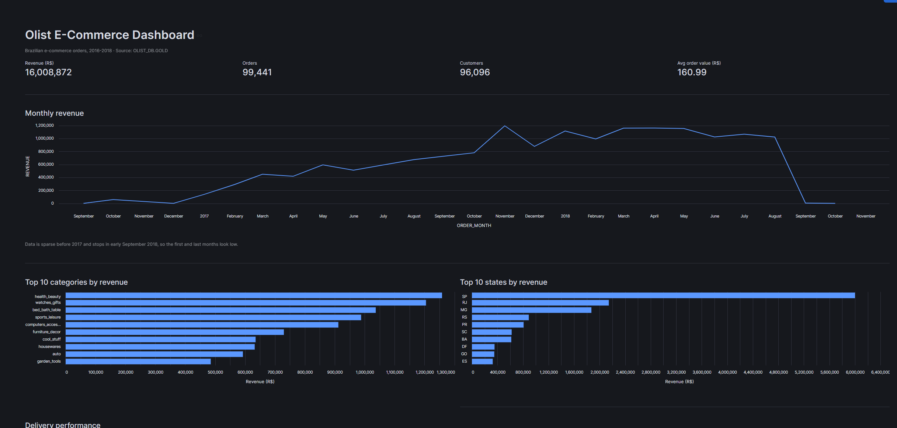
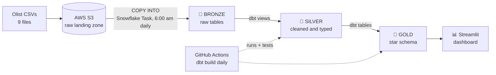
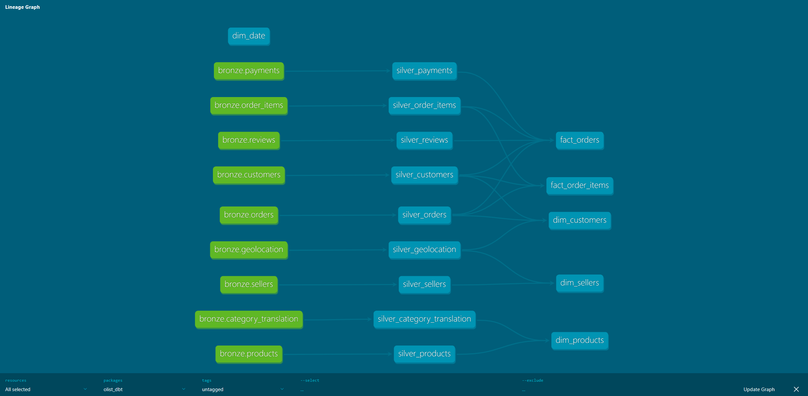

# Olist E-Commerce Data Pipeline: Medallion Architecture on Snowflake

An end-to-end ELT pipeline that takes ~100,000 real e-commerce orders from raw CSV files in AWS S3 to a tested star schema in Snowflake and an interactive dashboard, running automatically every day.

**Stack:** AWS S3 · Snowflake · dbt Core · GitHub Actions · Streamlit in Snowflake · SQL · Python



---

## Architecture



| Layer | What it holds | Built with |
|---|---|---|
| **Bronze** | Raw CSV data loaded as-is (all text), plus `_source_file` and `_loaded_at` lineage columns | `COPY INTO` from an S3 external stage |
| **Silver** | 9 cleaned views: proper types, clear names, exact duplicates removed | dbt (views) |
| **Gold** | Star schema: 4 dimensions and 2 fact tables, ready for analytics | dbt (tables) |

### dbt lineage



---

## Data model (Gold)

| Table | Grain (one row per…) | Rows |
|---|---|---|
| `fact_orders` | order (totals, payment, review score, delivery performance) | 99,441 |
| `fact_order_items` | item in an order (price, freight) | 112,650 |
| `dim_customers` | real person (`customer_unique_id`), with latest location and order history | 96,096 |
| `dim_products` | product, with English category names | 32,951 |
| `dim_sellers` | seller, with approximate map coordinates | 3,095 |
| `dim_date` | calendar day, 2016–2018 | 1,096 |

There are two fact tables because payments and reviews belong to a whole order while prices belong to each item. Items, payments and reviews are summarised per order before joining, so that order-level values aren't counted more than once (fan-out).

---

## Key findings

- **Late delivery halves customer satisfaction.** On-time orders average **4.29★**, late orders **2.27★**. Even 1–3 days late costs about a full star.
- **Retention is very low.** Only **3.1%** of customers ever placed a second order (2,997 of 96,096).
- **Revenue grew strongly through 2017, then plateaued** at ~R$1M/month in 2018. The peak month was November 2017 (Black Friday).
- **Revenue is concentrated in São Paulo,** which accounts for ~37% of the total.
- **6.8%** of delivered orders arrived after the estimated date. The average delivery time was **12.5 days**.

---

## Data quality and testing

- **43 dbt tests** (`unique`, `not_null`, `accepted_values`, `relationships`) across Silver and Gold.
- `dbt build` runs models and tests together in dependency order. If a test fails, the models that depend on it are skipped, so bad data doesn't reach Gold.
- Every load was validated against source row counts and money totals (e.g. total payments R$16,008,872.12 matches from Silver to Gold).

**Data issues found and handled:**

| Issue | Decision |
|---|---|
| 261,831 exact duplicate rows in geolocation (26%) | Removed in Silver |
| ~39 coordinates per zip prefix | Averaged to one point per zip in Gold |
| `review_id` repeated across 814 rows | Kept: one review can cover several orders (grain = review + order) |
| 610 products with no category | Labelled `unknown` |
| 2 categories missing an English translation | Fall back to the Portuguese name |
| Misspelled source columns (`product_name_lenght`) | Renamed in Silver |
| 3 payments of type `not_defined` (R$0) | Kept as real records |

---

## Automation

| Time (Sydney) | Job | Tool |
|---|---|---|
| 6:00 am | Load new S3 files into Bronze (`COPY INTO` skips already-loaded files) | Snowflake Task |
| 7:30 am | `dbt build`: rebuild Silver and Gold, run all tests | GitHub Actions |

GitHub Actions connects with **key-pair authentication**. The private key is stored as an encrypted GitHub secret, written to a temporary file during the run, and deleted when the job ends. A failed test fails the run and triggers an email alert.

---

## Security

- **dbt runs as a dedicated service user** (`DBT_USER`, key-pair only, no password) with a **least-privilege role** (`DBT_ROLE`): read Bronze, write Silver and Gold.
- **No secrets in the repo.** `profiles.yml` lives outside the project locally. The CI profile only reads environment variables.
- **S3 access is read-only**, scoped to a single bucket.

---

## Challenges and how I solved them

- **Excel silently corrupted the raw CSVs.** After the data had been opened and saved in Excel, every timestamp in Silver came out NULL. A validation query caught it. Excel had reformatted dates (removing seconds) and stripped leading zeros from zip codes. I replaced the files with the originals and reloaded Bronze.
- **Role-based S3 access was blocked on the AWS Free plan.** I configured a Snowflake storage integration with an IAM role and used CloudTrail to debug the `AssumeRole` denial. Cross-account access wasn't permitted on the account, so I switched to a read-only IAM user scoped to one bucket. The role-based setup is kept in `snowflake/01_storage_integration.sql` for reference.
- **Snowflake MFA blocked password logins for dbt.** I set up key-pair authentication. A lowercase username caused a JWT mismatch, which led to creating a dedicated uppercase service user.

---

## Repository structure

```
├── .github/workflows/dbt_daily_build.yml   # Daily dbt build (GitHub Actions)
├── snowflake/                              # Setup SQL, run in order (00 → 08)
│   ├── 00_setup.sql                        # Warehouse and cost controls
│   ├── 01_storage_integration.sql          # Role-based S3 access (reference only)
│   ├── 02_database_schemas.sql             # Database and Bronze/Silver/Gold schemas
│   ├── 03_file_format_stage.sql            # CSV format and S3 stage
│   ├── 04_bronze_tables.sql                # Bronze tables
│   ├── 05_bronze_load.sql                  # COPY INTO from S3
│   ├── 06_bronze_validation.sql            # Row-count checks
│   ├── 07_dbt_role_user.sql                # dbt service user and role
│   └── 08_bronze_load_task.sql             # Daily load task
├── olist_dbt/                              # dbt project
│   ├── models/silver/                      # 9 cleaning models + tests
│   ├── models/gold/                        # Star schema + tests
│   ├── macros/generate_schema_name.sql     # Builds Gold models in the GOLD schema
│   └── ci/profiles.yml                     # CI profile (environment variables only)
├── streamlit/dashboard.py                  # Streamlit in Snowflake dashboard
├── docs/                                   # Screenshots
└── requirements.txt                        # dbt-core, dbt-snowflake
```

---

## Running it yourself

1. Download the [Olist dataset from Kaggle](https://www.kaggle.com/datasets/olistbr/brazilian-ecommerce) and upload each CSV to its own folder in an S3 bucket. **Don't open and save the files in Excel.**
2. Run the files in `snowflake/` in order (add your own AWS access keys in `03` when running it; never commit them).
3. Set up dbt:
   ```bash
   python -m venv .venv
   pip install -r requirements.txt
   cd olist_dbt
   dbt debug      # needs ~/.dbt/profiles.yml with your Snowflake details
   dbt build
   ```
4. Create a Streamlit app in Snowflake and paste in `streamlit/dashboard.py`.

---

**Dataset:** [Brazilian E-Commerce Public Dataset by Olist](https://www.kaggle.com/datasets/olistbr/brazilian-ecommerce) (CC BY-NC-SA 4.0)
